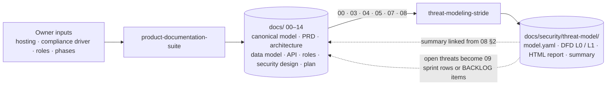
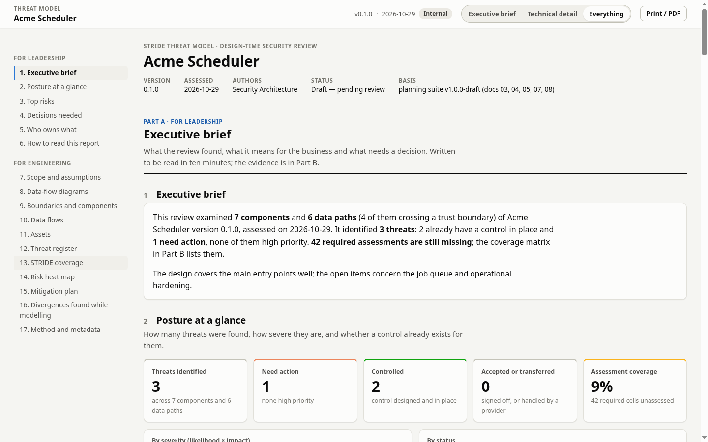
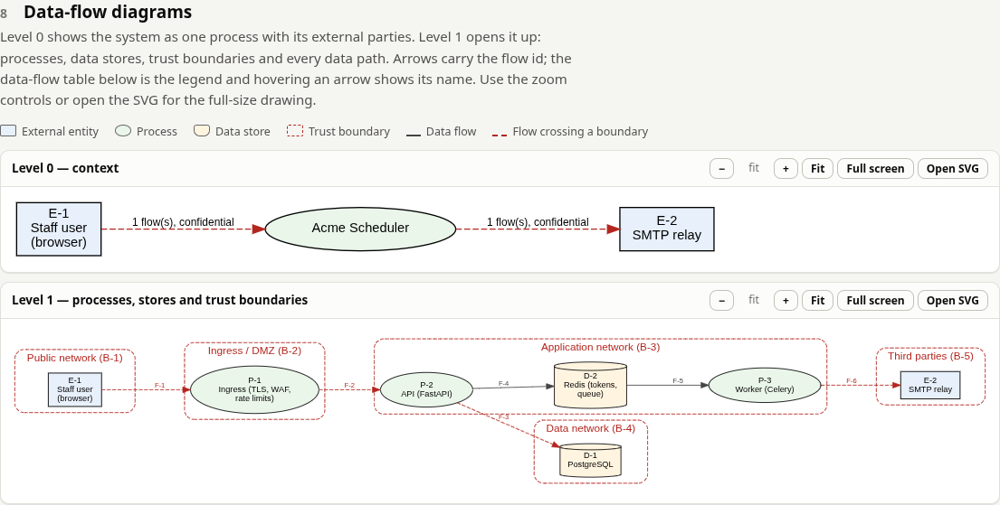
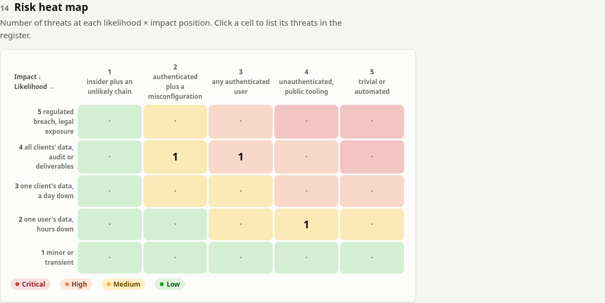
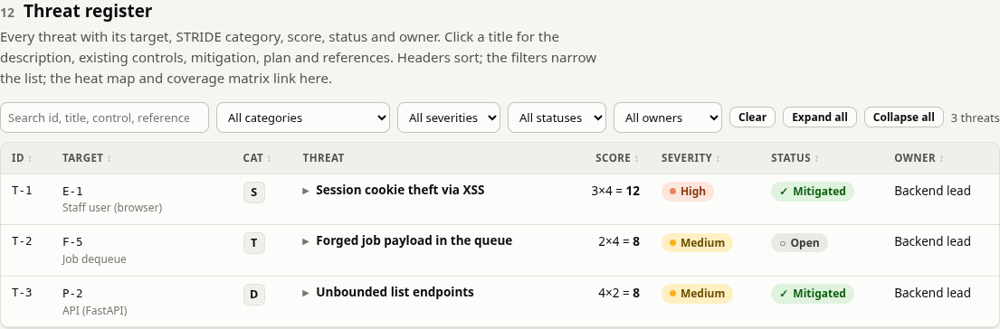

<h1 align="center">Secure by Design Skills</h1>

<p align="center">
  Two <a href="https://docs.claude.com/en/docs/claude-code/skills">Claude Code skills</a> that take a software product from planning documents to a reviewed STRIDE threat model, before the first line of code.
</p>

<p align="center">
  <a href="https://github.com/Cy-S3c/secure-by-design-skills/actions/workflows/validate.yml"></a>
  <a href="LICENSE"></a>
  
  
</p>

---

Most planning folders are an index of twenty documents, most of them marked
*Planned*. Most threat models are a diagram with no trust boundaries and a
page of threats written per component in prose. Both look like work and
neither can be reviewed, approved or kept current.

These two skills enforce the structure that makes the work reviewable, and
each one ships a script that checks the result mechanically:

| Skill | What Claude produces with it | Mechanical check |
|---|---|---|
| [`product-documentation-suite`](skills/product-documentation-suite/) | One canonical domain model and a fixed set of numbered documents (PRD, architecture, data model, API contract, requirements with acceptance criteria, roles and permissions, security design, sprint plan, runbooks, guides) written in dependency order and brought to approval. Also audits an existing `docs/` folder. | `audit_suite.py` — header blocks, identifier families, citations, sprint-to-requirement links, permission parity, README index. Exit 1 on any FAIL. |
| [`threat-modeling-stride`](skills/threat-modeling-stride/) | A STRIDE-per-element threat model from those documents (or from an existing codebase): data-flow diagrams with trust boundaries, a rated and owned threat register, a coverage matrix, a heat map and a self-contained HTML report with a leadership part and an engineering part. | `build_report.py` — rejects categories an element type cannot have, orphan elements and flows between unknown elements; requires a named approver on any accepted Critical or High threat; generates the diagrams from the model so they can never disagree with it. |

## How the two fit together



The documentation suite already contains every input a data-flow diagram
needs: principals in 00, components and flows in 03, data classes in 04,
endpoints in 05, roles in 07, trust boundaries and abuse cases in 08. The
threat-modeling skill reads them, builds the model, and writes its summary
back where the security design document links it. Open threats become sprint
rows; architecture changes re-run the model. Each skill also works alone.

## What the report looks like

The HTML report is one file with an audience switch. Part A reads in ten
minutes with no jargon; Part B is the engineering record.

| Part A: executive brief and posture at a glance | Part B: data-flow diagrams with trust boundaries |
|---|---|
|  |  |
| **Part B: risk heat map** (click a cell to filter the register) | **Part B: threat register** (search, filters, sortable, expandable records) |
|  |  |

A complete example built from the bundled model is in
[`examples/threat-model/`](examples/threat-model/): the
[model](examples/threat-model/model.yaml), the
[summary](examples/threat-model/threat-model-summary.md), both SVG diagrams
and the
[report](https://htmlpreview.github.io/?https://github.com/Cy-S3c/secure-by-design-skills/blob/main/examples/threat-model/threat-model.html)
(rendered through htmlpreview; or download `threat-model.html` and open it).

## Installation

Pick one method. Installing the same skill twice (for example as a plugin and
as a copied folder) loads it twice.

**As a Claude Code plugin** (one command, updates with `claude plugin update`):

```bash
claude plugin marketplace add Cy-S3c/secure-by-design-skills
claude plugin install secure-by-design-skills@secure-by-design
```

**As user-level skills** (available in every project on this machine):

```bash
git clone https://github.com/Cy-S3c/secure-by-design-skills.git
cp -r secure-by-design-skills/skills/product-documentation-suite ~/.claude/skills/
cp -r secure-by-design-skills/skills/threat-modeling-stride ~/.claude/skills/
```

**As project-level skills** (committed with a repository so everyone who
clones it gets them):

```bash
mkdir -p .claude/skills
cp -r secure-by-design-skills/skills/product-documentation-suite .claude/skills/
cp -r secure-by-design-skills/skills/threat-modeling-stride .claude/skills/
```

Start a new Claude Code session afterwards. Other agents that read `SKILL.md`
folders (the [Agent Skills](https://agentskills.io) layout) take the same
folders in their own skills directory.

### Requirements

| Need | Used by | Install |
|---|---|---|
| Python 3.9 or newer | both scripts | system package or python.org |
| PyYAML | `build_report.py`, to read `model.yaml` (a model written as JSON needs nothing extra) | `pip install pyyaml` |
| Graphviz `dot` | `build_report.py`, to draw the data-flow diagrams inline so the report is one self-contained file | `sudo apt install graphviz` · `brew install graphviz` · `choco install graphviz` |

Without Graphviz the report still builds; the diagrams fall back to a Mermaid
block loaded from a CDN, so that page needs network access to show them.

### Verify

```bash
python3 ~/.claude/skills/product-documentation-suite/scripts/audit_suite.py --help
python3 ~/.claude/skills/threat-modeling-stride/scripts/build_report.py \
  ~/.claude/skills/threat-modeling-stride/templates/model.example.yaml --check
```

The second command prints `OK  7 elements, 6 flows (4 cross-boundary), 3 threats, 42 coverage gap(s)` and exits 0.

## Quick start

The skills load on their own when a request matches their description, or on
request by name.

**Plan a product.** Four inputs block the work and must come from you:
hosting and tenancy model, compliance driver, the role set, the phases you
want. Everything else becomes a stated assumption or an open question with a
recommended default.

> Use the product-documentation-suite skill. We are planning an invoice
> approval service: AWS, one tenant per customer, SOC 2 is the compliance
> driver, roles are admin, approver and submitter, two phases. Write the
> Standard profile into docs/.

**Audit an existing docs folder.**

> Audit docs/ with the product-documentation-suite skill, Full profile, and
> give me the gap table before changing anything.

**Threat-model the design** (greenfield, from the suite):

> Use the threat-modeling-stride skill on docs/ and produce the model, the
> diagrams and the report in docs/security/threat-model/. Write the executive
> summary and the decisions needed for leadership.

**Threat-model an existing system** (brownfield, from the code):

> Threat-model this repository with the threat-modeling-stride skill. Take the
> elements from the deployable units and the configuration, cite code paths
> for every mitigated threat, and record every document-versus-code
> disagreement as a divergence.

Running the scripts by hand:

```bash
# audit a suite (drop --allow-missing for the final run before approval)
python3 skills/product-documentation-suite/scripts/audit_suite.py docs/ --profile standard --allow-missing

# validate a model, then build the report, the two SVGs and the summary beside it
python3 skills/threat-modeling-stride/scripts/build_report.py docs/security/threat-model/model.yaml --check
python3 skills/threat-modeling-stride/scripts/build_report.py docs/security/threat-model/model.yaml
```

## The method in brief

**Documentation suite.** One canonical model (00) owns roles, entities,
enumerations, state machines, the stack and a parameter register, and every
other document cites it rather than restating it. Documents are written in
dependency order (00 → 01 → 07 → 06 → 04 → 05 → 03 → 08 → 09 → 02 → README
→ 13/14, with 10 and 11/12 where the profile includes them), each from a template with a fixed header block, stable section
numbers and identifier families (`FR-x.y`, `ADR-NNN`, `A#`, `S##-B#`,
`PRM-n`). A sizing profile says which documents a product needs; the rest
are listed as not applicable with a reason. The README carries a status
banner and a decisions-needed list so the approver answers only what they
disagree with. Full rules: [`references/`](skills/product-documentation-suite/references/).

**Threat model.** Trust boundaries are first-class; every element of the
data-flow diagram is asked the six STRIDE questions it can have (entities:
S R; processes: all six; stores: T R I D; flows: T I D); every answer is rated
likelihood × impact on written 1–5 scales, given an owner and a status
(`open` with a plan row, `mitigated` with the control cited, `accepted` with
an approver, `transferred` with the agreement). Cells assessed and found
empty are recorded as `no_threat` with a reason, so the coverage matrix shows
judgement rather than omission. Disagreements between sources are
divergences, which are findings. Full rules: [`references/`](skills/threat-modeling-stride/references/).

## Repository layout

```
.
├── skills/
│   ├── product-documentation-suite/   SKILL.md · references/ · templates/ (00–14, ADR, BACKLOG, deferred, README) · scripts/audit_suite.py
│   └── threat-modeling-stride/        SKILL.md · references/ · templates/model.example.yaml · scripts/ (build_report.py, report_html.py, tm_common.py, assets/)
├── examples/threat-model/             the bundled example model and everything the generator writes from it
├── docs/images/                       screenshots used in this README
├── .claude-plugin/                    plugin and marketplace manifests
├── .github/workflows/validate.yml     CI: front matter, both scripts, example build, example freshness
├── CHANGELOG.md · CONTRIBUTING.md · LICENSE
```

## Versioning

Each skill has its own `metadata.version` in `SKILL.md` and follows semantic
versioning; the plugin version is the highest skill version. Changes are
recorded in [`CHANGELOG.md`](CHANGELOG.md).

## Contributing

Issues and pull requests are welcome. [`CONTRIBUTING.md`](CONTRIBUTING.md)
lists the checks to run and the conventions to keep.

## License

[MIT](LICENSE).
