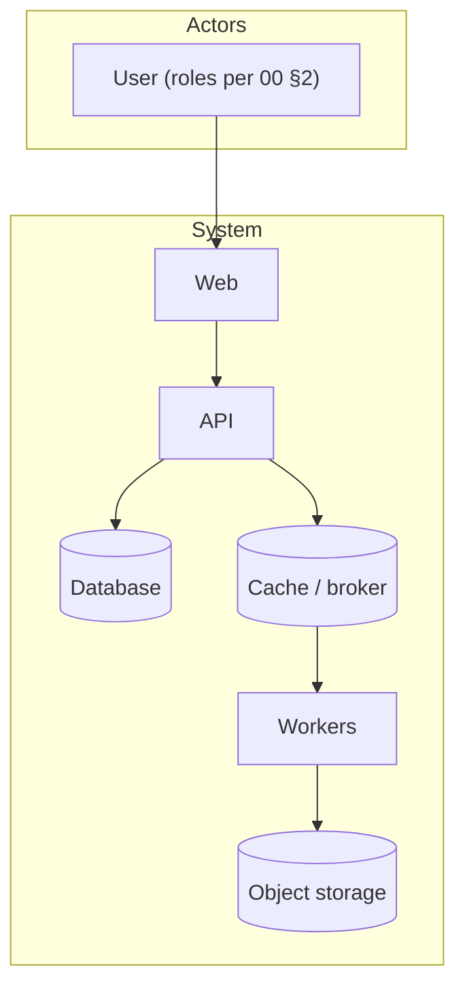

# 03 — Architecture & Wireframes

| | |
|---|---|
| **Document ID** | {{PREFIX}}-ARC-001 |
| **Product** | {{PRODUCT}} |
| **Version** | 1.0.0-draft |
| **Status** | Pending approval |
| **Owner** | Architecture |
| **Last updated** | {{DATE}} |
| **Audience** | Engineering, DevOps, security review |
| **Depends on** | `00-canonical-model.md`, `01-product-design-document.md` §6, §7, `05-api-documentation.md` §6.1 |
| **Consumed by** | `08-security-design.md`, `09-development-plan.md`, `11-frontend-design-system.md`, `12-frontend-screen-specifications.md`, `13-runbooks.md` |

> **Purpose.** How the system is built and deployed and the decisions that
> shape it. It is **not** the storage design (04), the contract (05) or the
> security controls (08). The event envelope is owned by
> `05-api-documentation.md` §6.1 and cited here.

---

## Table of Contents

---

## 1. Architecture Overview

<!-- Style in one sentence, then C4 L1 context and L2 containers as prose bullets plus a Mermaid diagram; L3 components for the core service. Every component listed here gets a STRIDE row in 08 §2.1. -->



### 1.1 Development topology
### 1.2 Production topology

## 2. ADR-001 — <Architectural style>

<!-- The full record of ADR-001 lives here; 01 §7 points to this section. -->

### 2.1 Context
### 2.2 Trade-off analysis

| Option | Pros | Cons | Verdict |
|---|---|---|---|

### 2.3 Evolution plan
### 2.4 Enforced rules (what prevents rewrites)

## 3. Module Catalogue

<!-- Must match 01 §4 and 06 §1.4. Event names follow 05 §6.3. -->

| Module | Responsibility | Key domain entities | API prefix | Events published | Events consumed | Phase |
|---|---|---|---|---|---|---|
| **<module>** | | `Entity` | `/api/v1/<resources>` | `module.entity.verb` | — | 1 |

Event envelope: `05-api-documentation.md` §6.1.

## 4. Request Lifecycle

### 4.1 Standard request path
### 4.2 <Critical async flow>

## 5. Frontend Architecture

### 5.1 Route structure (incl. sign-in and every navigation item in 07 §8)
### 5.2 Server vs client rendering strategy
### 5.3 State & data caching
### 5.4 Key client components

## 6. Background Jobs

| Job | Trigger | Idempotency | Timeout / budget | Failure handling |
|---|---|---|---|---|

## 7. Caching

## 8. Data Flows

### 8.1 <Upload / ingest flow>
### 8.2 <Generation / export flow>
### 8.3 <Isolation boundary flow>

## 9. Deployment

### 9.1 Development (compose)
### 9.2 Production (orchestrator — if this is a decision with alternatives, write "Proposed ADR (number assigned at back-port)" and number it in 01 §7 during the consistency pass)
### 9.3 Environments (owned here; 09 §1.7 cites it)

| Environment | Purpose | Data | Deploy |
|---|---|---|---|

### 9.4 Configuration (pointer to `13-runbooks.md` §3)
### 9.5 Backup & DR

## 10. Observability

| Signal | Tooling | Key fields / metrics | SLO |
|---|---|---|---|
| Logs | | `trace_id`, actor, resource (no personal data) | |
| Metrics | | | p95 < … |
| Traces | | | |

## 11. UI Wireframes (ASCII)

<!-- With 12 present: at most six journey-level wireframes; without 12: the ten most important screens. -->

### 11.1 (a) <Screen>

```
┌──────────────────────────────────────────────┐
│ Topbar: <product> · search · user menu       │
├──────────┬───────────────────────────────────┤
│ Sidebar  │ <Page title>            [Primary] │
│ · Item   │ ┌───────────────────────────────┐ │
│ · Item   │ │ table / cards with real labels│ │
└──────────┴───────────────────────────────────┘
```

## 12. Open Items

1. <question>? — *default: <default>*.

## 13. References
