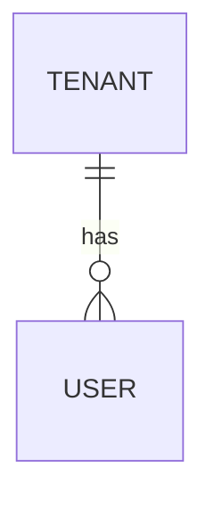

# 04 — Data Model & Database Design

| | |
|---|---|
| **Document ID** | {{PREFIX}}-DBD-001 |
| **Product** | {{PRODUCT}} |
| **Version** | 1.0.0-draft |
| **Status** | Pending approval |
| **Owner** | Data Architecture |
| **Last updated** | {{DATE}} |
| **Audience** | Backend, DBA, security review |
| **Depends on** | `00-canonical-model.md` (entities §3, enums §4, parameters §10), `01-product-design-document.md` §7, `10-domain-specification.md` §3, `07-user-roles-and-permissions.md` §4, `06-features-and-functions.md` |
| **Consumed by** | `05-api-documentation.md`, `08-security-design.md`, `09-development-plan.md`, `13-runbooks.md` |

> **Purpose.** The authoritative physical data design: principles, ERD,
> DDL-level table definitions (<dialect>), JSON contracts, indexing and query
> strategy, retention, migrations, cache keys, volume estimates. It is **not**
> the vocabulary (00) or the API shape (05). Entity, field and enum names are
> taken verbatim from `00-canonical-model.md`; a term missing there is added
> there first (`[CANON-PENDING: Term]` only after approval).

---

## Table of Contents

---

## 1. Design Principles

| # | Principle | Decision |
|---|---|---|
| P1 | **Primary keys** | UUID v7 generated application-side; no sequential IDs exposed |
| P2 | **Temporal columns** | `created_at`, `updated_at` timestamptz on every table; maintained by <ORM/trigger> |
| P3 | **Actor attribution** | `created_by` on every table; mutation history in the audit table |
| P4 | **Soft delete** | `deleted_at` on business entities; partial unique indexes on `deleted_at IS NULL`; append-only tables never soft-deleted |
| P5 | **Tenancy** | every tenant-owned table carries `tenant_id`; composite `(tenant_id, id)` foreign keys make cross-tenant references impossible (§1.5) |
| P6 | **Enum strategy** | native enum types for closed sets copied from 00 §4; `text` + registry for evolving sets; expand pattern for changes (§10 map) |
| P7 | **JSON columns** | schema-validated on write; GIN-indexed where filtered |
| P8 | **Audit** | explicit service-layer audit rows, not triggers; guards only |
| P9 | **Rich text** | structured JSON document, never raw HTML |
| P10 | **Binary objects** | object storage; rows hold key, hash, mime, size; URLs derived, never stored |
| P11 | **Time semantics** | instants as timestamptz; wall-clock values with an IANA zone column; date-only as `date` |
| P12 | **Encryption at rest** | <which columns are encrypted, key hierarchy, where keys live — cite 08 §6.3> |

### 1.1 Soft-delete policy per entity
### 1.2 Required extensions
### 1.3 Naming conventions
### 1.4 Database roles & row-level security

<!-- Application roles (app, migrator, readonly), RLS policies per tenant-owned table, how the tenant context is set. -->

### 1.5 Tenancy pattern

<!-- The composite FK shape, the circular dependency (tenants ↔ users) and how it is bootstrapped. -->

## 2. Entity-Relationship Diagram



## 3. Table Definitions (DDL)

### 3.1 Enumerated types
### 3.2 `tenants` — tenant root

```sql
CREATE TABLE tenants (
    id uuid PRIMARY KEY,
    ...
    created_at timestamptz NOT NULL DEFAULT now(),
    updated_at timestamptz NOT NULL DEFAULT now(),
    deleted_at timestamptz
);
```

<!-- Per table: columns, constraints, indexes, invariants, which FRs it serves. -->

## 4. JSON Schema Contracts

### 4.1 `<table>.<column>` — <contract name>

## 5. Indexes & Performance

### 5.1 Non-PK index register

| Table | Index | Columns / predicate | Serves query |
|---|---|---|---|

### 5.2 Materialised views
### 5.3 Canonical query patterns

## 6. Data Lifecycle & Retention

### 6.1 Per-entity retention

| Entity | Retention (00 §10 PRM-n) | Erasure method |
|---|---|---|

### 6.2 Erasure / anonymisation
### 6.3 Archival
### 6.4 Backup strategy (pointer to `13-runbooks.md` §5)

## 7. Migrations & Versioning

### 7.1 Seed data

## 8. Cache Key Schema

| Key pattern | Value | TTL | Owner module |
|---|---|---|---|

## 9. Volume Estimates

### 9.1 Row counts (steady state, year 1)
### 9.2 Object storage
### 9.3 Capacity signals (ops alerts)

## 10. Enum → Type Map

| 00 §4 enumeration | Storage | Evolution |
|---|---|---|
| `Entity.status` | native type `entity_status` | expand pattern |

## Appendix A — Traceability to canonical model

| 00 entity | Table(s) |
|---|---|

## Appendix B — Open Items

1. <question>? — *default: <default>*.
